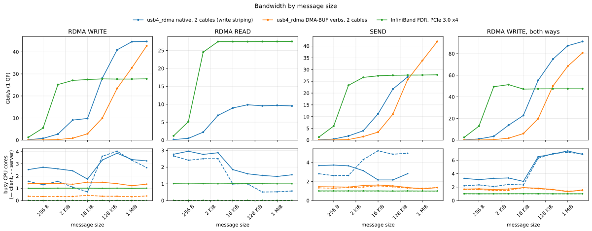
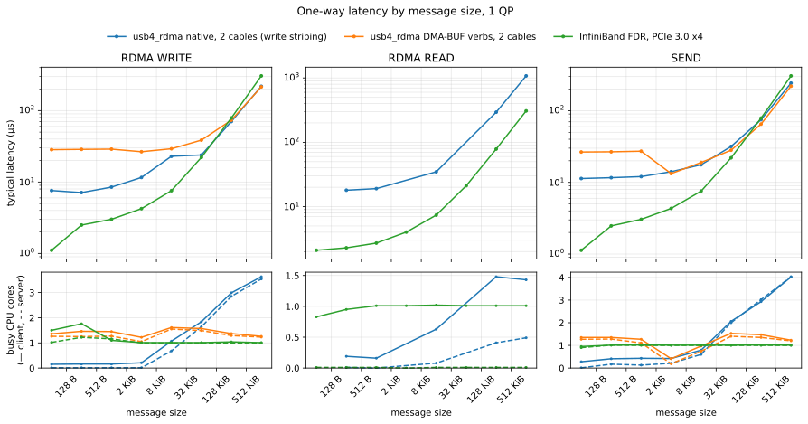

# Donnerkeule (`thunderbolt-ibverbs`)

> [!NOTE]
> Donnerkeule is a fork of [thunderbolt-ibverbs](https://github.com/hellas-ai/thunderbolt-ibverbs) for **AMD Strix Halo** systems connected with two USB4 cables. It stripes RDMA transfers across all four USB4 DMA rails so applications using a single QP (such as [gufo-rdma](https://github.com/neuhaus/gufo)) reach ~95% of FDR InfiniBand performance.
> Requires **Linux ≥ 7.2** (tested on 7.2.x and 7.3.x).

> [!WARNING]
> Research driver — not hardened for production or untrusted peers.


## Build and Install with DKMS

### 1. Install build prerequisites

Fedora:

```sh
sudo dnf install dkms gcc git kernel-devel kernel-headers kmod make rdma-core perftest
```

Debian / Ubuntu:

```sh
sudo apt install build-essential dkms git kmod "linux-headers-$(uname -r)" rdma-core perftest
```

Arch Linux:

```sh
sudo pacman -S --needed base-devel dkms git kmod linux-headers rdma-core perftest
```

### 2. Build and install the kernel module

```sh
git clone https://github.com/neuhaus/donnerkeule.git
cd donnerkeule

sudo make dkms-add
sudo make dkms-build
sudo make dkms-install
```

`dkms-build` and `dkms-install` target the running kernel by default; pass `KVER=<kernel-release>` to target another installed kernel. DKMS automatically rebuilds the module after kernel upgrades.

To uninstall:

```sh
sudo make dkms-remove
```

### 3. Configure `modprobe.d`, dummy RoCE netdev, and udev

`thunderbolt_net` automatically binds to USB4 peer links and claims DMA rings that RDMA rails need, so blacklist it and point `thunderbolt_ibverbs` at a dummy netdev for RoCE GID addressing:

```text
# /etc/modprobe.d/thunderbolt-ibverbs.conf
blacklist thunderbolt_net
options thunderbolt_ibverbs roce_netdev=tbv0

# /etc/modules-load.d/thunderbolt-ibverbs.conf
thunderbolt_ibverbs
```

Create the dummy netdev (use a different IP on the second host, e.g. `192.168.240.2/24`):

```sh
sudo nmcli connection add type dummy ifname tbv0 con-name tbv0 \
  ipv4.method manual ipv4.addresses 192.168.240.1/24 ipv6.method disabled
```

Prevent `rdma-core`'s udev rule from renaming `usb4_rdma*` devices (the userspace provider matches by name):

```sh
sudo cp /usr/lib/udev/rules.d/60-rdma-persistent-naming.rules /etc/udev/rules.d/
# Edit /etc/udev/rules.d/60-rdma-persistent-naming.rules so the rename rule excludes usb4_rdma*:
# KERNEL!="hfi1*", KERNEL!="usb4_rdma*", PROGRAM="rdma_rename %k NAME_FALLBACK"
```

### 4. Load and verify

Connect both USB4 cables between the two hosts and load the module on both:

```sh
sudo modprobe thunderbolt_ibverbs
ibv_devices
# device       node GUID
# usb4_rdma0   ...
# usb4_rdma1   ...
# usb4_rdma5   ...
# usb4_rdma6   ...
```

Test bandwidth (replace `<peer-ip>` with the peer's Ethernet/management IP):

```sh
# Host A (server)
ib_write_bw -d usb4_rdma0 -x 1 -s 4194304 --report_gbits

# Host B (client)
ib_write_bw -d usb4_rdma0 -x 1 -s 4194304 --report_gbits <peer-ip>
```

---

## Module Parameters

All Strix Halo optimizations are enabled by default. A standard build exposes four parameters:

| Parameter | Default | Description |
| --- | --- | --- |
| `roce_netdev` | *(none)* | Netdev used for RoCE GID metadata (e.g. `tbv0`). |
| `dmabuf_verbs` | `1` | `1` = DMA-BUF descriptor verbs mode (default, lowest CPU, GPU DMA-BUF MRs); `0` = native framed mode (lower small-message latency, supports RDMA READ). |
| `lanes` | `"2"` | Lanes per cable (`2`, `1`, `auto`, or `MIN-MAX`). Two cables × two lanes = four rails. |
| `native_domain_mask` | `~0u` | Bitmask of Thunderbolt domain indices to use (e.g. `1` or `2` to isolate a single cable). |

To switch to native framed mode for a session:

```sh
sudo modprobe -r thunderbolt_ibverbs
sudo modprobe thunderbolt_ibverbs dmabuf_verbs=0
```

Development and A/B tuning knobs (`dmabuf_batch_doorbell`, `dmabuf_post_burst`, `dmabuf_poll_us`, `native_write_striping`, `native_tx_max_inflight`, `qp_timeout_ms`, `nhi_interrupt_throttle_ns`, etc.) are compiled in behind `TBV_DEV_PARAMS=1`:

```sh
make TBV_DEV_PARAMS=1 modules
```

Run `modinfo thunderbolt_ibverbs` after a build for the authoritative list of parameters compiled into your module.

---

## Performance Overview





- **DMA-BUF verbs mode (`dmabuf_verbs=1`, default):** Uses 1.3–1.9 busy CPU cores, reaches ~41–42 Gb/s at 4 MiB, supports GPU DMA-BUF MRs directly (used by `gufo`), and has lower SEND latency from 64 KiB upward. Does not implement RDMA READ; small WRITE/SEND latency is ~30 µs. See [docs/GPU_VERBS.md](docs/GPU_VERBS.md).
- **Native framed mode (`dmabuf_verbs=0`):** Reaches ~44.5 Gb/s on 1–64 MiB WRITEs with ~13 µs 4 KiB WRITE latency, supports RDMA READ (~9.5 Gb/s up to 4 MiB), and provides full frame-level retransmission.

How the charts are generated: [bench/README.md](bench/README.md#readme-charts).

---

## Running `gufo` TP=2 Over Two USB4 Cables

With the module loaded and `tbv0` configured on both hosts:

```sh
# Rank 0
gufo serve llm --model MODEL.gguf --tp-world-size 2 --tp-rank 0 \
  --tp-bootstrap-port 18515 --tp-control-port 18516 \
  --tp-control-token SHARED_TOKEN --tp-rdma-device usb4_rdma0

# Rank 1
gufo serve llm --model MODEL.gguf --tp-world-size 2 --tp-rank 1 \
  --tp-bootstrap-host RANK0_ADDRESS --tp-bootstrap-port 18515 \
  --tp-control-port 18516 --tp-control-token SHARED_TOKEN \
  --tp-rdma-device usb4_rdma0
```

Any of the four `usb4_rdma*` devices can be passed; its QP stripes across all four rails automatically.

---

## Checking USB4 Link Speed and Diagnostics

USB4 links occasionally train at 10 Gb/s instead of 20 Gb/s per lane after boot. Check both ends:

```sh
for d in /sys/bus/thunderbolt/devices/*-*; do
  [ -e "$d/rx_speed" ] && echo "$(basename "$d") rx $(cat "$d/rx_speed") x $(cat "$d/rx_lanes")" \
    "tx $(cat "$d/tx_speed") x $(cat "$d/tx_lanes")"
done
```

Full-speed USB4 40 Gb/s links report `20.0 Gb/s` × `2` lanes in both directions. If a link trains down, replug the cable.

Runtime counters and per-rail state live in debugfs:

```sh
sudo cat /sys/kernel/debug/thunderbolt_ibverbs/summary
sudo cat /sys/kernel/debug/thunderbolt_ibverbs/peers
```

Load with `dyndbg=+p` to log rail bring-up details (works even under Secure Boot kernel lockdown).

Board-specific notes for Sixunited AXB35 (Bosgame M5, GMKtec EVO-X2, etc.) and Framework Desktop are in [docs/STRIX_HALO_BOARDS.md](docs/STRIX_HALO_BOARDS.md).

---

## Userspace Provider & Containers

The kernel module runs on the host. Inside a container (PyTorch, vLLM, llama.cpp), install the `usb4-rdma-provider` package so stock `libibverbs` enumerates `usb4_rdma*`:

```sh
docker run --rm -it \
    --device=/dev/infiniband \
    --cap-add=IPC_LOCK --ulimit memlock=-1 \
    pytorch/pytorch:latest bash

apt install -y ibverbs-utils ./usb4-rdma-provider_<version>.<codename>_amd64.deb
ibv_devices
```

Pre-built provider packages are published on the [upstream releases page](https://github.com/hellas-ai/thunderbolt-ibverbs/releases).

---

## Alternative Builds (Without DKMS / Nix)

One-off build against the running kernel without DKMS:

```sh
make KVER="$(uname -r)"
sudo make KVER="$(uname -r)" modules_install
sudo depmod -a
```

Nix flake outputs (Linux):

```sh
nix build .#thunderbolt-ibverbs   # kernel module
nix build .#rdma-core-usb4        # libibverbs + usb4_rdma provider
nix build .#perftest              # ib_write_bw / ib_send_bw / ib_read_bw
nix build .#bench-tools           # verification and benchmark helpers
```

On NixOS, import `nixosModules.default` and set `hardware.thunderbolt-ibverbs.enable = true`.

---

## License

The kernel module is licensed under `GPL-2.0-only` (`MODULE_LICENSE("GPL")`). Small userspace-facing test and protocol helper files marked `GPL-2.0 OR BSD-3-Clause` may be used under either license.
